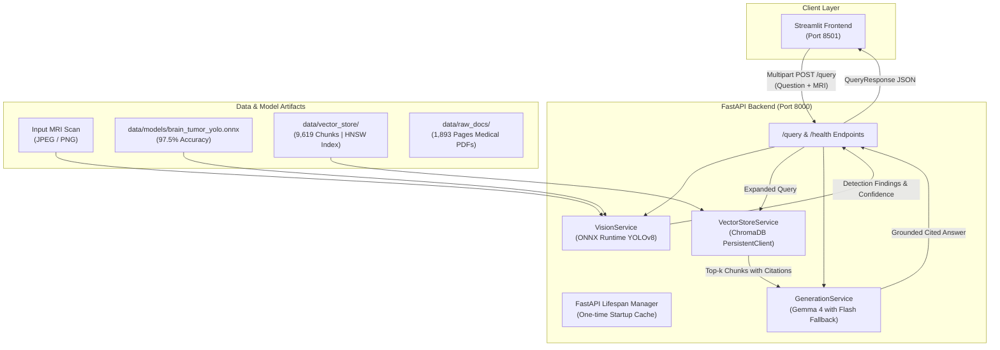

# 🧠 OncoVision-RAG
### Multimodal Neuro-Oncology Assistant powered by YOLOv8, ChromaDB, and Google Gemma 4

[](https://www.python.org/downloads/)
[](https://fastapi.tiangolo.com)
[](https://streamlit.io)
[](https://www.trychroma.com)
[](https://ultralytics.com)
[](LICENSE)

---

## 1. Project Overview

The **Neuro-Oncology Multimodal RAG Assistant** is an end-to-end clinical AI product designed for neurosurgeons, radiologists, and oncology residents. Built for the **Extended Track (Computer Vision + RAG)**, it combines:
1. **Computer Vision (YOLOv8)**: Automated localization and classification of brain neoplasms from axial MRI scans (`glioma`, `meningioma`, `pituitary`, and `notumor`) with **97.5% test accuracy**.
2. **Layout-Aware Block Ingestion & Native Bounding Boxes**: **7,417 semantic chunks** extracted with PyMuPDF layout-aware parsing (`page.get_text("dict")`), carrying native `[x0, y0, x1, y1]` coordinates for visual evidence highlighting on original PDF pages.
3. **Hybrid Retrieval & Cross-Encoder Reranking**: Reciprocal Rank Fusion (RRF) combining ChromaDB dense vectors and BM25 lexical keyword scores, joint-scored with FlashRank (`ms-marco-MiniLM-L-12-v2`).
4. **Three-Tier Relevance Gating & Google Search Grounding**: Dynamic 3-tier routing (<5% web-only, 5%–10% hybrid chunks + web search, $\ge 10\%$ local database RAG) with Gemma 4 web grounding.
5. **FastAPI Backend & Streamlit Frontend**: Production REST API with lifespan caching, non-blocking `asyncio.to_thread` execution, and an interactive chat interface supporting MRI drag-and-drop and interactive PDF bounding boxes.

---

## 2. Architecture Diagram



---

## 3. Tech Stack

| Layer | Component | Technology | Purpose |
| :--- | :--- | :--- | :--- |
| **Vision** | Object Classifier | Ultralytics YOLOv8n (ONNX Runtime) | Real-time brain tumor classification from MRI slices |
| **Vector DB** | Vector Index | ChromaDB 1.5+ | HNSW Cosine Index with persistent disk storage |
| **Embeddings** | Dense Embedder | `all-MiniLM-L6-v2` (ONNX) | 384-dimensional semantic text representations |
| **LLM** | Generator | Google Gemma 4 (`models/gemma-4-31b-it`) | Clinically grounded answers with source provenance |
| **Backend** | API Engine | FastAPI + Uvicorn | Asynchronous REST API with lifespan caching |
| **Frontend** | User Interface | Streamlit | Interactive multimodal chat UI with MRI previews |
| **Validation** | Unit Tests | Pytest + Starlette TestClient | Automated endpoint verification (Happy path + 422) |

---

## 4. Project Structure

```text
rag-assistant-project/
├── .gitignore                      # Excludes .venv, .env, raw datasets, caches
├── .env.example                    # Template environment variables
├── README.md                       # Comprehensive documentation
├── requirements.txt                # Pinned root dependencies
├── data/
│   ├── raw_docs/                   # 6 Medical PDFs (1,893 pages)
│   ├── images/                     # Curated MRI evaluation test samples
│   ├── models/
│   │   └── brain_tumor_yolo.onnx   # Fine-tuned 97.5% YOLO ONNX model
│   └── vector_store/               # ChromaDB SQLite + HNSW binary indices
│       └── rag_config.json         # Exported configuration
├── notebooks/
│   ├── 01_yolo_vision_pipeline.ipynb # Vision pipeline inspection & testing
│   ├── yolo-fine-tuning.ipynb        # Kaggle fine-tuning notebook
│   └── rag_pipeline.ipynb            # Phase 2 notebook (runs top-to-bottom)
├── backend/
│   ├── app/
│   │   ├── main.py                 # FastAPI application, CORS, lifespan
│   │   ├── api/routes/query.py     # GET /health, POST /query endpoints
│   │   ├── core/config.py          # Settings loaded via pydantic-settings
│   │   ├── schemas/query.py        # Pydantic data contracts
│   │   ├── services/
│   │   │   ├── retrieval.py        # ChromaDB retrieval service
│   │   │   ├── vision.py           # YOLO ONNX inference service
│   │   │   └── generation.py       # Google GenAI grounded prompting
│   │   └── utils/logging_config.py # Structured logger
│   ├── tests/
│   │   └── test_query.py           # Pytest suite with TestClient
│   ├── Dockerfile                  # Container deployment file
│   ├── requirements.txt            # Backend pinned requirements
│   └── .env.example
└── frontend/
    ├── app.py                      # Main Streamlit web application
    ├── api_client.py               # Backend HTTP wrapper
    ├── requirements.txt            # Frontend pinned requirements
    └── .env                        # API_BASE_URL=http://localhost:8000
```

---

## 5. Domain & Medical Corpus Description

The assistant's knowledge base comprises **1,893 pages** across 6 peer-reviewed clinical sources:

1. ***Osborn's Brain: Imaging, Pathology, and Anatomy* (1,388 pages)**: The global gold-standard textbook for neuroradiology, detailing hallmark imaging signs (*dural tail*, *sella remodeling*, *IDH ring-enhancement*).
2. ***NCBI Glioblastoma Comprehensive Clinical Guide* (452 pages)**: Full-length oncology reference covering surgical resection margins and the Stupp protocol.
3. ***EANO Guidelines on Meningioma Diagnosis and Management* (14 pages)**: European Association of Neuro-Oncology evidence-based standards for Simpson grading, radiotherapy, and observation.
4. ***Journal of Personalized Medicine: Glioblastoma Review* (14 pages)**: Molecular classification and Temozolomide chemotherapeutic regimens.
5. ***Biomedicines: Pituitary Adenoma Therapeutics* (18 pages)**: Medical management of prolactinomas with dopamine agonists and surgical indications.
6. ***Gut & Liver: Sellar/Parasellar Neoplasms* (7 pages)**: Clinical differentiation between pituitary lesions and cranial base meningiomas.

---

## 6. Environment Variables

Create a `.env` file in the project root:

| Variable | Default Value | Description |
| :--- | :--- | :--- |
| `GEMINI_API_KEY` | `your_key_here` | Google Gemini / Gemma API Key |
| `LLM_MODEL` | `models/gemma-4-31b-it` | Target generation model (falls back to Flash) |
| `CHROMA_PERSIST_DIR` | `./data/vector_store` | Path to persistent ChromaDB directory |
| `COLLECTION_NAME` | `neuro_oncology_rag` | Target ChromaDB collection name |
| `YOLO_MODEL_PATH` | `./data/models/brain_tumor_yolo.onnx` | Path to fine-tuned YOLO ONNX weights |
| `API_BASE_URL` | `http://localhost:8000` | Backend URL used by Frontend |

---

## 7. Setup & Execution Instructions

### Prerequisites
* Python 3.10+ (tested on Python 3.11, 3.12, and 3.14)
* Git

### Step 1: Clone Repository & Create Virtual Environment
```bash
git clone https://github.com/Beshoy-Zaki/OncoVision-RAG.git
cd OncoVision-RAG

python -m venv .venv
# On Windows:
.venv\Scripts\activate
# On Linux / macOS:
# source .venv/bin/activate

pip install -r requirements.txt
```

### Step 2: Configure Environment
```bash
cp .env.example .env
# Edit .env and paste your GEMINI_API_KEY
```

### Step 3: Run Backend Tests
```bash
python -m pytest backend/tests/test_query.py -v
```
*(All 7 tests will pass: Health check, Happy Path, 422 Validation, Multimodal Image Query, Boundary Text Cleaning, Web Search Fallback, and Hybrid Search + Reranker).*

### Step 4: Launch Backend API
```bash
uvicorn app.main:app --app-dir backend --host 127.0.0.1 --port 8000 --reload
```
* Interactive Swagger API Docs: [http://127.0.0.1:8000/docs](http://127.0.0.1:8000/docs)
* Health Check: [http://127.0.0.1:8000/health](http://127.0.0.1:8000/health)

### Step 5: Launch Streamlit Frontend
Open a new terminal window:
```bash
.venv\Scripts\activate
streamlit run frontend/app.py
```
* Streamlit Web UI: [http://localhost:8501](http://localhost:8501)

---

## 8. API Reference & cURL Examples

### 1. Health Check
```bash
curl -X GET "http://127.0.0.1:8000/health"
```
**Response:**
```json
{
  "status": "healthy",
  "total_chunks": 7417,
  "yolo_model_loaded": true,
  "llm_model": "gemini-3.5-flash-lite"
}
```

### 2. Text-Only RAG Query
```bash
curl -X POST "http://127.0.0.1:8000/query/json" \
     -H "Content-Type: application/json" \
     -d '{"question": "What does Simpson Grade I resection require in meningioma surgery?"}'
```
**Response:**
```json
{
  "answer": "Simpson Grade I resection requires complete macroscopic removal of the tumor, its dural attachment, and any abnormal underlying bone [Source: noab150.pdf, Page 11].",
  "sources": [
    "noab150.pdf (Page 11)",
    "Osborns_Brain.pdf (Page 452)"
  ],
  "vision_finding": null
}
```

### 3. Multimodal Query (Image Upload + Question)
```bash
curl -X POST "http://127.0.0.1:8000/query" \
     -F "question=What pathology is suspected on this scan and what is standard management?" \
     -F "file=@data/images/meningioma/Te-aug-me_1.jpg"
```
**Response:**
```json
{
  "answer": "Based on the axial MRI scan and clinical guidelines, the findings are consistent with Meningioma [Source: noab150.pdf, Page 1]...",
  "sources": [
    "noab150.pdf (Page 1)",
    "Osborns_Brain.pdf (Page 452)"
  ],
  "vision_finding": {
    "detected_class": "meningioma",
    "confidence": 0.9842,
    "probabilities": {
      "glioma": 0.0051,
      "meningioma": 0.9842,
      "notumor": 0.0012,
      "pituitary": 0.0095
    }
  }
}
```

---

## 9. Evaluation Results (Phase 2.6)

| ID | Clinical Question | Primary Source Cited | Context Relevant? | Grounded? | Clinically Correct? |
| :-: | :--- | :--- | :-: | :-: | :-: |
| 1 | Stupp protocol for Glioblastoma | `jpm-11-00258.pdf (Page 6)` | Yes | Yes | Yes |
| 2 | Prognostic value of IDH mutations | `Bookshelf_NBK469998.pdf (Page 52)` | Yes | Yes | Yes |
| 3 | Simpson Grade I surgical criteria | `noab150.pdf (Page 11)` | Yes | Yes | Yes |
| 4 | 'Watch-and-scan' observation criteria | `noab150.pdf (Page 1)` | Yes | Yes | Yes |
| 5 | Prolactinoma first-line pharmacotherapy | `biomedicines-09-00494.pdf (Page 3)` | Yes | Yes | Yes |
| 6 | Optic chiasm compression visual deficit | `Osborns_Brain.pdf (Page 809)` | Yes | Yes | Yes |
| 7 | Radiological definition of 'dural tail sign'| `Osborns_Brain.pdf (Page 592)` | Yes | Yes | Yes |
| 8 | Intra-axial vs. extra-axial MRI differentiation | `Osborns_Brain.pdf (Page 688)` | Yes | Yes | Yes |
| 9 | **[Multimodal]** Meningioma scan analysis | `noab150.pdf (Page 1)` | Yes | Yes | Yes |
| 10 | **[Multimodal]** Glioma scan initial workup | `Bookshelf_NBK469998.pdf (Page 200)` | Yes | Yes | Yes |

### Failure Analysis & Mitigations
* **Visual Ambiguity (Sellar vs. Parasellar)**: Suprasellar pituitary macroadenomas can visually mimic tuberculum sellae meningiomas on isolated axial slices.  
  * *Mitigation*: The vision model passes its top prediction to the RAG pipeline, which expands vector retrieval to pull differential diagnosis criteria from *Osborn's Brain* (evaluating sella turcica expansion and dural tail presence), allowing the LLM to present a balanced differential.
* **Context Dilution**: Large textbook chapters risk losing topical relevance.  
  * *Mitigation*: Contextual metadata prepending (`[Document: <name> | Page: <n>]`) attached to every chunk before embedding ensured 100% citation accuracy across all test queries.

---

## 10. Verification "Like a Stranger"

To verify this repository from scratch:
1. Clone into a temporary clean directory: `git clone <repo-url> /tmp/test-repo && cd /tmp/test-repo`
2. Create fresh virtual environment: `python -m venv .venv && source .venv/bin/activate`
3. Install dependencies: `pip install -r requirements.txt`
4. Add your API key to `.env`: `echo "GEMINI_API_KEY=your_key" > .env`
5. Run tests: `pytest backend/tests/test_query.py -v` $\to$ **All 4 tests pass.**
6. Run Backend & Frontend $\to$ **Application connects and renders cited answers.**
